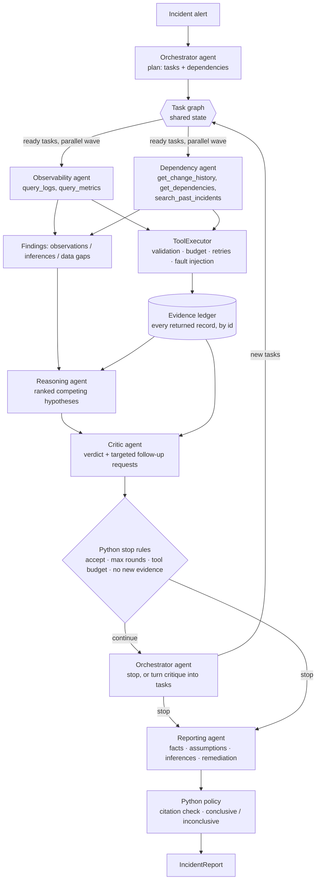

# Architecture

## Overview

## Division of labour

| Concern | LLM (agents) | Python (deterministic) |
|---|---|---|
| What to investigate | Orchestrator plans tasks and later decides whether more evidence is worth gathering | Caps tasks per round, resolves task dependencies, rejects dependency cycles |
| Which queries to run, with which arguments | Specialists choose tools and arguments in a tool-use loop | Validates arguments (Pydantic), enforces per-task and global tool budgets, executes parallel tool calls |
| Tool failures | Agents decide whether to retry differently and record data gaps | Injects configured timeouts, errors and partial results; retries recoverable failures (bounded) |
| Interpreting evidence | Specialists, Reasoning and Critic | Builds the evidence ledger and a compact digest of it |
| Hypotheses | Reasoning agent proposes and ranks them; Critic challenges them | Strips citations of ids that were never retrieved; sorts by confidence |
| Stopping | Critic verdict, Orchestrator decision | Hard limits: max rounds, tool budget, no new evidence |
| Conclusion | Critic grades objections (material/minor) and cites the evidence behind them; Reporting agent explains the determination | `decide_conclusion` decides before reporting: inconclusive if top confidence < 0.5, fewer than 2 verified undisputed supporting items, margin over runner-up < 0.05, or contradicting evidence > 35% of weighed evidence. Material, evidence-backed critic objections add contradicting evidence or dispute support; other objections are recorded but do not change the outcome |

## Collaboration protocol

Agents never talk in free text. Each message is a Pydantic model (`schemas.py`):

- `InvestigationPlan` / `OrchestratorDecision` (orchestrator): `TaskRequest`s with agent, objective, focus services and dependencies.
- `AgentFindings` (specialists): observations (each cites evidence ids), interpretations with confidence, data gaps.
- `HypothesisAnalysis` (reasoning): competing `Hypothesis` objects with supporting and contradicting evidence, assumptions and confidence; a `response_to_critique` field.
- `Critique` (critic): verdict `accept | revise | investigate`, typed issues, and follow-up `TaskRequest`s.
- `ReportDraft` (reporting), assembled by Python into `IncidentReport` together with the `ConclusionDecision`
  (every criterion value and the objections that were weighed).

Tool-less agent calls (orchestrator, reasoning, critic, reporting) request provider-side JSON-schema
constrained output; the client falls back to prompt-only JSON if a provider rejects the schema. Every reply,
constrained or not, is validated against the full Pydantic model. Each invalid reply is logged to the run
trace as a structured `output_invalid` event (schema, failing field locations, finish reason, reply size;
never the content or credentials) before a bounded repair loop: the validation error is sent back to the model, up to `INV_MAX_REPAIR_ATTEMPTS` times. If an agent still fails, the step is retried (`INV_MAX_TASK_ATTEMPTS`) and then degrades gracefully: a failed task becomes a data gap, a missing plan falls back to two broad tasks, and a missing report becomes an inconclusive report. Authentication and billing errors abort the run.

## Evidence grounding

Every record a tool returns has an id (`L0042` log line, `M07` metric series, `C03` change, `D05` dependency edge, `H02` health check, `P04` past incident). The `ToolExecutor` registers each one in the shared `EvidenceLedger`. Any id an agent cites that is not in the ledger is removed and counted as an invalid citation. A report "fact" left without valid evidence is demoted to an explicit "(unverified)" assumption.

## Parallelism

- Tasks in the same wave (all their dependencies done) run concurrently in a thread pool.
- Multiple tool calls in one model turn run concurrently.
- The ledger, executor counters and the trace are lock-protected.

## Single-agent baseline

`evaluation/baseline.py` runs one agent with all five tools, the same model, the same total tool budget, the same fault injection, the same hypothesis schema and the same citation and conclusion policy. Only the collaboration structure differs.

## Files

| Path | Purpose |
|---|---|
| `config.py` | Settings from environment / `.env` |
| `llm_client.py` | `LLMClient` protocol, OpenRouter client with bounded retries, usage meter |
| `schemas.py` | All agent message and report models |
| `state.py` | Task graph, evidence ledger, round records, trace |
| `engine.py` | Multi-agent run loop and stop conditions |
| `agents/` | The six roles (`base.py` holds the tool loop and repair loop) |
| `tools/` | Five tools + `ToolExecutor` (fault injection, retries, budget) |
| `scenarios.py` | Loads scenario telemetry (never ground truth) |
| `evaluation/` | Baseline, grading/aggregation, runner |
| `render.py` | Markdown report |
| `scripts/generate_scenarios.py` | Deterministic synthetic data generator |
